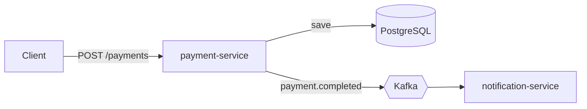

# Bill Payment Event Pipeline

Small event-driven system built to practise **Docker, Kafka and Kubernetes** on a utility bill-payment use case.



## Run

```bash
docker compose up --build
```

## Try it

```bash
curl -X POST localhost:8080/payments \
  -H "Content-Type: application/json" \
  -d '{"accountId":"ACC1001","amount":1250.50}'

docker compose logs -f notification-service
```

You should see a log like `SMS -> account ACC1001: payment of 1250.50 received`.

## Design decisions
- **Kafka key = accountId**: events of one account stay ordered inside a partition.
- **Producer `acks=all` + idempotence**: no lost or duplicated writes on retries.
- **Multi-stage Dockerfile, slim JRE, non-root user**: small and safer images.

## Roadmap
- [ ] ledger-service (consumer with retry + dead-letter topic, idempotent processing)
- [ ] Transactional outbox (avoid DB-write vs Kafka-publish inconsistency)
- [ ] Kubernetes manifests (kind) with probes, resource limits, HPA
- [ ] GitHub Actions: build, test, docker build
