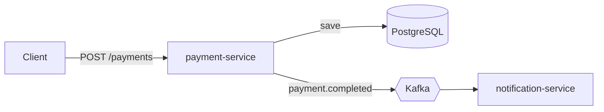
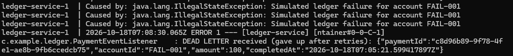
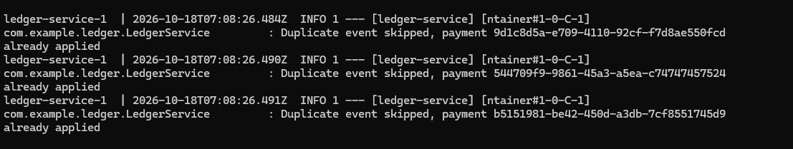
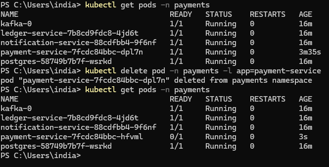

# Bill Payment Event Pipeline

Small event-driven system built to practise **Docker, Kafka and Kubernetes** on a utility bill-payment use case.



## Run

```bash
docker compose up --build
```

## Try it

```bash
Invoke-RestMethod -Method Post -Uri http://localhost:8082/payments `
  -ContentType "application/json" `
  -Body '{"accountId":"ACC1001","amount":1250.50}'

docker compose logs -f notification-service
```

You should see a log like `SMS -> account ACC1001: payment of 1250.50 received`.





## Design decisions
- **Kafka key = accountId**: events of one account stay ordered inside a partition.
- **Producer `acks=all` + idempotence**: no lost or duplicated writes on retries.
- **Multi-stage Dockerfile, slim JRE, non-root user**: small and safer images.

## Roadmap
- [ ] ledger-service (consumer with retry + dead-letter topic, idempotent processing)
- [ ] Transactional outbox (avoid DB-write vs Kafka-publish inconsistency)
- [ ] Kubernetes manifests (kind) with probes, resource limits, HPA
- [ ] GitHub Actions: build, test, docker build

## Run on Kubernetes (kind)

```powershell
docker build -t payment-service:local ./payment-service
docker build -t notification-service:local ./notification-service
docker build -t ledger-service:local ./ledger-service
kubectl apply -f k8s/
kubectl get pods -n payments
```

Includes startup/readiness/liveness probes, resource requests and limits, ConfigMap and Secret, and initContainers that wait for Postgres and Kafka.

Self-healing and scaling:



### Known limitations
- Kafka data is on `emptyDir`, so it is lost if the pod is deleted (demo only).
- Topics are auto-created on first use. In production, create them explicitly.
- payment-service writes to Postgres and publishes to Kafka separately (dual write). A transactional outbox would fix this.